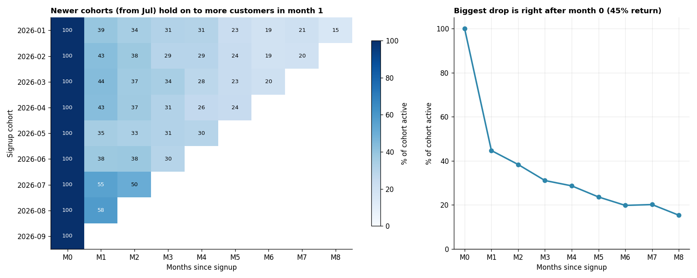

# Cohort Retention Analysis

**Tools:** Python, Pandas, NumPy, Matplotlib

**File:** [`Cohort Retention Analysis.py`](./Cohort%20Retention%20Analysis.py)

**Chart:** [`charts/cohort_retention_heatmap.png`](./charts/cohort_retention_heatmap.png)



## What I Learned

A **cohort** is a group of customers who share the same starting point, here the month they signed up. **Cohort analysis** follows each group over time and asks: *of the people who joined in January, how many are still active 1, 2, 3 months later?*

Analogy: think of school batches. Judging a school by one overall pass rate hides the story. Comparing the 2024 batch with the 2025 batch shows whether teaching is actually improving. A blended average of all customers hides exactly this kind of change.

The business question: *how well do we keep customers, and are newer customers sticking around better than older ones?*

## Workflow

| Step | What happens | Why it matters |
|------|--------------|----------------|
| 0 | Build `users` and `activity` tables | Cohorts need a signup date and a log of activity |
| 1 | Assign each user to a signup-month cohort (`to_period("M")`) | Defines the groups |
| 2 | Merge activity with cohort, compute `months_since` | Puts every cohort on a common timeline (M0, M1, M2...) |
| 3 | Count **unique** active users per cohort and month offset | One user with 5 orders is still one active user |
| 4 | Divide by cohort size to get retention % | Makes cohorts of different sizes comparable |
| 5 | Mask future cells and plot a heatmap | Blank is "no data yet", not 0% |
| 6 | Weighted average curve and early-vs-late comparison | Summarise and test whether things improved |

## Results (simulated data, 2,752 users, Jan to Sep 2026 signups)

**Average retention curve** (weighted by cohort size):

| Month since signup | M0 | M1 | M2 | M3 | M4 | M5 | M6 | M7 | M8 |
|--------------------|----|----|----|----|----|----|----|----|----|
| % still active | 100 | 44.7 | 38.3 | 31.1 | 28.7 | 23.6 | 19.8 | 20.2 | 15.4 |

**Month-1 retention before vs after the July onboarding change:**

| Cohorts | Month-1 retention |
|---------|-------------------|
| Jan to Jun signups (6 cohorts) | 40.2% |
| Jul to Aug signups (2 cohorts) | 56.6% |

Newer cohorts keep noticeably more customers in the first month. Only two "after" cohorts exist, so this is a strong hint rather than proof, and the next step would be more months of data or a proper A/B test (see Day 3).

*The data is simulated, so these numbers describe the exercise, not a real business.*

## Key Concepts and Interview Points

**Why cohorts beat a single retention number.** If the customer base is growing, a blended retention figure is dominated by new, not-yet-churned users and looks healthier than it is. Cohorts separate "who joined when", so improvements and deteriorations show up clearly. A classic interview question: *"Overall retention is flat. How do you know whether the product is improving?"* Answer: look at cohorts.

**Read the heatmap in two directions.**
- **Down a column** (compare cohorts at the same age): is month-1 retention getting better for newer cohorts?
- **Across a row** (one cohort over time): how quickly does it decay, and does it flatten out?

**The triangle shape is expected.** Recent cohorts have had less time to age, so their later cells are empty. Showing those as 0% would be misleading, so the script masks them as blank.

**Use `nunique`, not `count`.** Retention counts *people*, not events. Counting orders would inflate the numbers for heavy buyers.

**Weight the average by cohort size.** A plain average of percentages gives a 260-user cohort the same say as a 340-user cohort. Dividing total active users by total cohort users is the correct weighting.

**The steepest drop is usually right after signup.** Here, only about 45% return in month 1. Fixing the first-month experience (onboarding, a welcome offer, a second-purchase reminder) tends to be the highest-leverage improvement, which is exactly what the simulated July change did.

**Beware small cohorts and short histories.** With only two cohorts after the change, one unusual month could create the difference. State the limitation openly, as the script does.

**Classic vs rolling retention.** *Classic* retention counts users active **in** month k. *Rolling* (or "return-on") retention counts users active in month k **or later**, so it never goes down. The two answer different questions, and mixing them up leads to wrong comparisons, so always define which one you report.

**Cohort by something other than signup month.** The same method works for acquisition channel, first product bought, plan type or country. Comparing retention across *channels* often shows which marketing spend brings loyal customers rather than one-time buyers.

**Connect retention to money.** A retained customer is worth more than a new one, and small gains in retention compound. This is why retention is a core metric for subscription and e-commerce businesses.

**Link to SQL.** The same table can be built with `DATE_TRUNC('month', ...)` for the cohort, a date difference for `months_since`, and `COUNT(DISTINCT user_id)` with `GROUP BY`, which builds on Day 7's joins and Day 1's date logic.

## How to Run

```bash
pip install numpy pandas matplotlib
python "Cohort Retention Analysis.py"
```

The script prints cohort sizes, the retention matrix and the comparison, and saves the chart in a `charts` folder next to it. The random seed is fixed, so your results match those above.

## Next Steps

- Rebuild the retention matrix in SQL and check it matches
- Add a revenue cohort view (average revenue per user by month since signup)
- Split cohorts by acquisition channel and compare retention
- Add a rolling-retention version and compare it with the classic one
