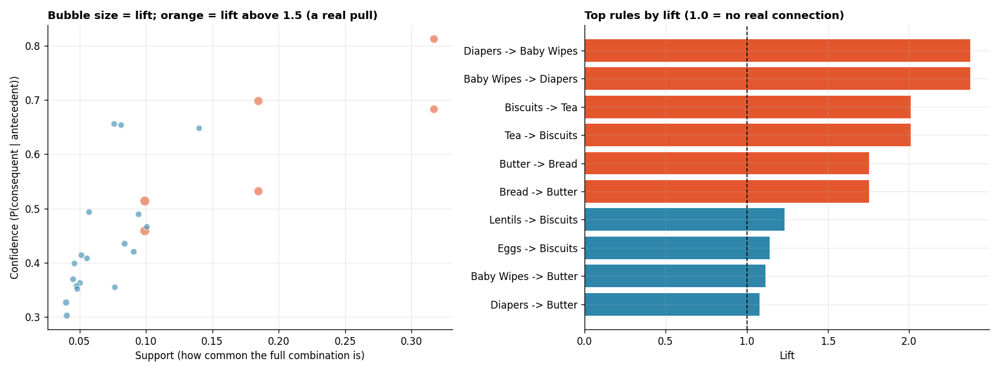

# Market Basket Analysis (Association Rules)

**Tools:** Python, Pandas, NumPy, mlxtend, Matplotlib

**File:** [`Market Basket Analysis.py`](./Market%20Basket%20Analysis.py)

**Chart:** [`charts/market_basket_rules.png`](./charts/market_basket_rules.png)



## What I Learned

"Customers who bought X also bought Y" is not a guess, it is a calculation. **Market basket analysis** looks at what items appear together in the same transaction and surfaces rules that can drive product placement, bundle deals and "customers also bought" recommendations. Analogy: a supermarket noticing that shoppers who grab bread usually grab butter too, so the two get placed on the same aisle.

The business question: *which products genuinely pull each other into the same basket, and which only look connected because one of them is popular?*

## Workflow

| Step | What happens | Why it matters |
|------|--------------|----------------|
| 0 | Build a transactions dataset (one row per basket) | Market basket analysis starts from raw baskets, not a customer table |
| 1 | One-hot encode into a basket matrix (`TransactionEncoder`) | The wide, item-as-column shape the algorithm expects |
| 2 | Apriori: find frequent itemsets | Efficiently skip combinations that cannot possibly be common |
| 3 | Generate association rules | Turn itemsets into "if A, then B" statements |
| 4 | Read one rule in plain language | Support, confidence and lift, explained with real numbers |
| 5 | The "popular item" trap | Show exactly why lift matters more than confidence alone |
| 6 | Turn the strongest rules into recommendations | Analysis that leads to an action |

## The Three Numbers Behind Every Rule

| Metric | Question it answers | Plain-English version |
|--------|--------------------|------------------------|
| **Support** | How common is this whole combination? | Out of every basket that left the store, what share had both items? |
| **Confidence** | Given A, how often does B follow? | Of the baskets with A, what % also had B? |
| **Lift** | Is this connection real, or just because B is popular anyway? | How many times more likely is B when A is present, versus B's normal rate? |

Lift above 1 means A genuinely pulls B in. Lift at or near 1 means no real connection, confidence was high only because B is common on its own. Lift below 1 means A pushes B away.

## Results (simulated data, 1,906 baskets)

The data was built around three hidden pairings (Bread–Butter, Tea–Biscuits, Diapers–Baby Wipes) plus one very popular, unrelated item (Milk, in 64% of all baskets), to check whether the analysis finds the real patterns and avoids the fake one.

**Top one-to-one rules, by lift:**

| Rule | Support | Confidence | Lift |
|------|---------|------------|------|
| Diapers → Baby Wipes | 9.9% | 45.9% | **2.38** |
| Baby Wipes → Diapers | 9.9% | 51.4% | **2.38** |
| Tea → Biscuits | 18.5% | 53.2% | **2.01** |
| Biscuits → Tea | 18.5% | 69.8% | **2.01** |
| Butter → Bread | 31.7% | 81.3% | **1.75** |
| Bread → Butter | 31.7% | 68.3% | **1.75** |

All three hidden pairings were found and ranked at the top, exactly where they should be.

**The popular-item trap, caught directly:**

| Rule | Confidence | Lift |
|------|-----------|------|
| Bread → Milk | 64.3% (looks strong) | **1.00** (no real connection) |
| Bread → Butter | 68.3% | **1.75** (a real connection) |

Both rules have similar confidence, but only one is meaningful. Milk is bought so often (64% of all baskets) that almost anything shows "high confidence" toward it by coincidence. Lift exposes the difference instantly: a lift of exactly 1.00 means a basket with Bread is no more likely to contain Milk than any random basket.

**Resulting recommendations** (lift above 1.5 and confidence above 40%):
- Place Baby Wipes near Diapers, or bundle them (2.4x more likely than chance)
- Place Biscuits near Tea, or bundle them (2.0x more likely than chance)
- Place Butter near Bread, or bundle them (1.8x more likely than chance)

*The data is simulated, so these numbers describe the exercise, not a real business.*

## Key Concepts and Interview Points

**Why the Apriori algorithm is needed at all.** With just 14 products there are thousands of possible combinations to check. Apriori's shortcut: if an itemset is rare, every larger itemset built from it must be at least as rare, because you cannot buy Bread+Butter+Jam more often than you buy Bread+Butter alone. This lets the algorithm skip checking huge numbers of combinations that are guaranteed to be rare, which is why it scales to real retail catalogues with thousands of products.

**Confidence alone is a trap.** A rule can have 60%+ confidence purely because the consequent item is bought by most customers anyway, not because the antecedent caused anything. The Bread → Milk example above makes this concrete: 64.3% confidence, but a lift of exactly 1.00 shows there is nothing meaningful there. Always check lift before acting on a rule. This is one of the most common ways market basket analysis goes wrong in practice, and a strong interview answer names it directly.

**Lift is not causation.** A high lift says two items are statistically pulled together, not that buying one *causes* someone to buy the other. Both could be driven by a third factor (a recipe, a festival, a promotion). Recommending a genuine product bundle is usually safe either way; claiming a causal story about customer behaviour is not.

**Support, confidence and lift can point in different directions.** A rule can have very high confidence and lift but tiny support, meaning it is reliable but rare (it barely affects the bottom line), or high support but modest lift (it affects many baskets but weakly). The chart's bubble plot shows this trade-off directly: a good rule to act on usually needs a healthy level of all three, not just one.

**Rules get noisier as itemsets grow.** The script separates simple one-to-one rules from multi-item ones. A multi-item rule with only 3.5% support can show a very high lift (around 4.0 here) purely because it covers so few baskets that one coincidence swings the number a lot. Simple pairwise rules, with more data behind them, are usually the safer and more explainable ones to act on first.

**`min_support` is a business lever, not just a technical parameter.** Setting it too low produces thousands of rules, most of them noise from rare, coincidental combinations. Setting it too high misses real but less common patterns (like the Diapers–Baby Wipes pairing, a smaller but very reliable segment). The right threshold depends on how much a team can realistically act on.

**One-hot encoding is the same shape as a pivot table.** Each row is a transaction and each column is a product, True or False. This is conceptually identical to the pivot tables from Day 5, just with boolean values instead of sums.

**Where this shows up in industry.** This is the same family of idea behind "frequently bought together" on e-commerce sites, cross-sell prompts at checkout, and shelf-placement decisions in physical retail. The same technique also applies outside retail: symptoms that co-occur in medical records, or pages visited together in a single website session.

## How to Run

```bash
pip install numpy pandas mlxtend matplotlib
python "Market Basket Analysis.py"
```

The script prints each step and saves the chart in a `charts` folder next to it. The random seed is fixed, so your results match those above.

## Next Steps

- Try FP-Growth (`mlxtend.frequent_patterns.fpgrowth`), a faster alternative to Apriori on larger catalogues, and compare the rules found
- Add a time dimension: do these pairings hold steady across months, or do they shift seasonally?
- Combine with Day 10's RFM segments: do high-value customers follow different basket patterns than occasional ones?
- Build a simple "customers who bought this also bought..." recommender from the rule table
