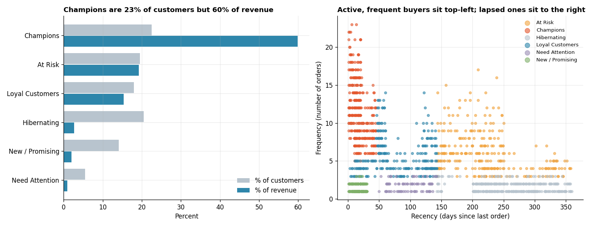

# RFM Customer Segmentation

**Tools:** Python, Pandas, NumPy, Matplotlib

**File:** [`RFM Customer Segmentation.py`](./RFM%20Customer%20Segmentation.py)

**Chart:** [`charts/rfm_segments.png`](./charts/rfm_segments.png)



## What I Learned

Treating every customer the same wastes money. **RFM analysis** scores each customer on three simple questions and then groups them into segments that marketing can act on. It is one of the most common analyst tasks in retail, e-commerce and subscription businesses.

| Letter | Question | Better is... |
|--------|----------|--------------|
| **R**ecency | How recently did they buy? | Fewer days since last order |
| **F**requency | How often do they buy? | More orders |
| **M**onetary | How much do they spend? | More money |

Analogy: think of a gym. The member who came yesterday, comes four times a week and pays for premium (a **Champion**) needs different treatment from one who came 10 times last year but has not shown up for 5 months (**At Risk**) and from one who joined last week (**New**).

## Workflow

| Step | What happens | Why it matters |
|------|--------------|----------------|
| 0 | Build a transactions table (one row per order) | RFM starts from raw orders |
| 1 | Calculate R, F, M per customer with `groupby().agg()` | Turn thousands of orders into one row per customer |
| 2 | Score each from 1 to 5 using quintiles (`qcut`) | Put three different units on one comparable scale |
| 3 | Map score combinations to named segments | 125 raw combinations are too many to act on |
| 4 | Summarise segments: size, revenue share, behaviour | Show where the money is |
| 5 | Check the 80/20 rule | Verify the common belief instead of assuming it |
| 6 | Assign an action to each segment | Analysis only matters if it changes a decision |

## Results (simulated data, 1,500 customers, 8,154 orders)

| Segment | Customers | % of customers | % of revenue | Avg orders | Avg days since last order |
|---------|-----------|----------------|--------------|------------|---------------------------|
| Champions | 338 | 22.5% | **59.9%** | 11.6 | 18.5 |
| At Risk | 293 | 19.5% | 19.2% | 6.0 | 223.1 |
| Loyal Customers | 269 | 17.9% | 15.3% | 5.8 | 78.8 |
| Hibernating | 307 | 20.5% | 2.7% | 1.6 | 263.6 |
| New / Promising | 211 | 14.1% | 2.0% | 1.3 | 16.0 |
| Need Attention | 82 | 5.5% | 1.0% | 1.8 | 98.1 |

**Key findings:**
- Champions are about 23% of customers but about 60% of revenue.
- The top 20% of customers by spend bring **61%** of revenue. That is concentrated, but not the textbook 80/20, which is why it is worth checking rather than quoting from memory.
- The **At Risk** group still holds 19.2% of historical revenue, but these customers used to buy often and have gone quiet (about 223 days). That is the most urgent group to win back.

*The data is simulated, so these numbers describe the exercise, not a real business.*

## Recommended Actions

| Segment | Action |
|---------|--------|
| Champions | Reward them: early access, loyalty perks, ask for reviews and referrals |
| Loyal Customers | Upsell and cross-sell; nudge toward Champion behaviour |
| New / Promising | Welcome series and a second-purchase offer to build the habit |
| At Risk | Urgent win-back: personal outreach and a "we miss you" offer |
| Need Attention | Reminder campaigns and offers based on past purchases |
| Hibernating | Low-cost reactivation test; stop heavy spend if there is no response |

## Key Concepts and Interview Points

**Fix the snapshot date.** Recency is "days since last order **as of a date**". Use a fixed snapshot date in the code, not the real today, otherwise the numbers change on every run and results cannot be reproduced.

**Recency scoring is reversed.** Fewer days since the last order is *better*, so the lowest recency gets the *highest* score (5). Forgetting to reverse it is the most common RFM bug.

**Why `rank(method="first")` before `qcut`.** Many customers share the same frequency (for example, 1 order), so `qcut` cannot create equal-sized bins and raises an error. Ranking first breaks ties and guarantees clean quintiles. The trade-off: two identical customers can land in different bins, so mention it if asked.

**Quintiles are relative, not absolute.** A score of 5 means "top 20% of *this* customer base", not "good by an absolute standard". When the business grows, the thresholds shift, so recalculate regularly.

**Segment rules are a business decision.** There is no single correct mapping. Rules should be reviewed with marketing, and the order of the rules matters because the first match wins (see the `segment()` function).

**Why not just sort by spend?** Total spend hides behaviour. A customer who spent a lot two years ago and never returned looks valuable on M alone, but R shows they are probably lost. RFM combines "how much" with "how recently and how often".

**Revenue concentration.** Always measure it. If 20% of customers bring 61% of revenue, losing a few Champions hurts far more than losing many Hibernating customers. This guides where to put retention budget.

**Limitations.** RFM ignores *what* people buy, margins, returns and channel. It is a quick, explainable starting point, and a clustering model such as K-means can follow it. A good interview answer: *"I would start with RFM because the business can understand it, then test whether clustering finds anything RFM misses."*

**Link to churn.** RFM is a cheap early-warning system: customers whose recency score drops while frequency was high are the classic churn candidates, which is exactly the At Risk group here.

**Link to SQL.** The same RFM table can be built with `MAX(order_date)`, `COUNT(*)`, `SUM(amount)` and `NTILE(5) OVER (ORDER BY ...)`, which connects to the window functions from Day 1.

## How to Run

```bash
pip install numpy pandas matplotlib
python "RFM Customer Segmentation.py"
```

The script prints each step and saves the chart in a `charts` folder next to it. The random seed is fixed, so your results match those above.

## Next Steps

- Rebuild the RFM table in SQL using `NTILE(5)` and compare it with the Pandas result
- Try K-means clustering on the scaled R, F and M values and compare the groups
- Add average order value and product category to see what each segment buys
- Track how customers move between segments from one month to the next
