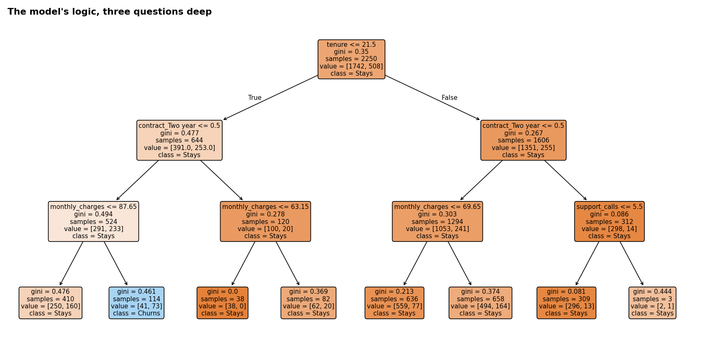

# Decision Trees & Random Forests

**Tools:** Python, Scikit-learn, Pandas, NumPy, Matplotlib

**File:** [`Decision Trees & Random Forests.py`](./Decision%20Trees%20&%20Random%20Forests.py)

**Charts:** [`charts/decision_tree_diagram.png`](./charts/decision_tree_diagram.png), [`charts/tree_forest_comparison.png`](./charts/tree_forest_comparison.png)



## What I Learned

A **decision tree** predicts by asking a series of yes/no questions, like the game 20 Questions or a flowchart: *"Is tenure under 21.5 months? If yes, does the customer have a two-year contract? If no, is the monthly charge over Rs. 87.65? ..."* Each answer narrows the group until the tree reaches a final guess.

A **random forest** builds hundreds of different trees, each on a random slice of the data and a random subset of features, and lets them vote. Analogy: asking 300 doctors for a second opinion and going with the majority, instead of trusting one doctor's judgement, which usually gives a steadier, more reliable answer.

This reuses the exact churn dataset from Day 13 (Logistic Regression), so the three models are judged on identical customers, a fair comparison instead of three separate stories.

## Workflow

| Step | What happens | Why it matters |
|------|--------------|----------------|
| 1 | Rebuild Day 13's churn dataset with the same seed | Fair, apples-to-apples comparison |
| 2 | Fit a shallow tree (depth 3) and read it as a flowchart | See the model's logic directly, unlike a "black box" |
| 3 | Compare train vs test accuracy across depths 1 to unlimited | See overfitting happen in real numbers |
| 4 | 5-fold cross-validation to pick the best depth | A more honest choice than reading one split |
| 5 | Fit a random forest, compare all three models | Does averaging many trees help? |
| 6 | Feature importance | Which signals the trees actually use |
| 7 | Score the same new customer as Day 13 | See how each model's opinion differs |

## Reading the Tree (top few levels)

The first and most important question the tree asks is **"Is tenure 21.5 months or less?"** That single split does most of the work. Below it, contract type and monthly charges refine the guess. A customer with short tenure, a non-two-year contract and a high bill lands in the single leaf the tree is most confident will churn (73 out of 114 similar customers in training did).

## Results (simulated data, same 750-customer test set as Day 13)

**Overfitting as depth increases:**

| max_depth | Train accuracy | Test accuracy | Gap |
|-----------|-----------------|----------------|-----|
| 1 | 77.4% | 77.5% | 0.0 |
| 3 | 78.8% | 78.3% | +0.6 |
| 5 (chosen by CV) | 79.9% | 77.9% | +2.0 |
| 8 | 84.2% | 75.2% | +9.0 |
| 12 | 92.7% | 70.8% | +21.9 |
| **Unlimited** | **100.0%** | **68.9%** | **+31.0** |

An unlimited tree memorises the training data perfectly and then performs *worse than guessing the majority class* on new customers. Cross-validation picked depth 5 as the sensible middle ground.

**All three models, same test set, threshold 0.50:**

| Model | Accuracy | Precision | Recall | F1 | ROC-AUC |
|-------|----------|-----------|--------|-----|---------|
| **Logistic regression** | 78.7% | 0.569 | 0.219 | 0.316 | **0.743** |
| Decision tree (depth 5) | 77.9% | 0.537 | 0.130 | 0.210 | 0.692 |
| Random forest (300 trees) | 79.5% | **0.674** | 0.172 | 0.274 | 0.726 |

**Random forest feature importance:**

| Feature | Importance |
|---------|-----------|
| Tenure | 0.381 |
| Monthly charges | 0.293 |
| Support calls | 0.108 |
| Contract: Two year | 0.104 |
| Contract: One year | 0.065 |
| Autopay | 0.050 |

**The same new customer as Day 13** (4 months tenure, Rs. 95 bill, 4 support calls, month-to-month, no autopay):

| Model | Predicted churn probability |
|-------|------------------------------|
| Logistic regression | 82.6% |
| Decision tree | 92.3% |
| Random forest | 84.7% |

*All data is simulated, so these numbers describe the exercise, not a real business.*

## Key Concepts and Interview Points

**Logistic regression won here, and that is the real lesson.** It is tempting to assume tree-based models are always stronger. In this data, churn was generated from smooth, mostly linear effects (each feature nudges risk up or down steadily), which is exactly the shape logistic regression is built for. Trees shine when relationships are sharply non-linear or involve complex interactions between features. The honest answer in an interview is: *"Try both and let the data decide, don't assume."*

**Why a tree overfits.** Each split only ever tries to reduce error on the training rows in front of it. With no depth limit, it keeps splitting until each leaf holds a handful of specific customers, memorising noise along with the real pattern. The train-vs-test gap in the table above **is** overfitting, shown as a number instead of just a concept.

**Why cross-validate the depth.** Reading one train/test split is tempting but can be lucky or unlucky. Five-fold cross-validation tries each depth on five different splits and averages the result, which is a sturdier basis for a decision. This is the same idea as Day 8's cross-validation, applied to picking a hyperparameter instead of judging a final model.

**Why forests usually beat a single tree.** A single tree is unstable: a slightly different training sample can produce a very different first split, which then cascades downward. A forest averages many such trees trained on different random samples (**bagging**, short for bootstrap aggregating), which smooths out that instability. Here the forest's AUC did beat the single tree's, just not logistic regression's.

**Feature importance has no sign.** It answers "how often and how usefully was this feature used to split the data", not "does it raise or lower risk". Tenure ranks highest by importance, matching the fact that it is the very first question the tree asks, and matching its strong odds ratio from Day 13. But importance alone cannot say *which direction*, while an odds ratio can. Knowing when to use which is a sign of real understanding.

**No scaling needed for trees.** Logistic regression needed `StandardScaler` because distances between numbers matter to it. A tree only asks "is this value above or below X?", so scaling changes nothing about where it draws the line. Trees also handle a mix of numeric and categorical features more naturally.

**Random forest hyperparameters that matter most.**

| Parameter | What it controls | Effect of increasing it |
|-----------|-------------------|--------------------------|
| `n_estimators` | Number of trees | More stable, more compute, usually fine to set high |
| `max_depth` | Depth per tree | Deeper trees fit more detail, risk overfitting |
| `min_samples_leaf` | Minimum customers per leaf | Higher values smooth out noisy, over-specific splits |

**Interpretability trade-off.** A depth-3 tree can be shown to a non-technical stakeholder and read like a flowchart. A forest of 300 trees cannot be read directly, though its feature importances and individual predictions can still be explained. Logistic regression's odds ratios are the most directly explainable of the three. Picking a model is not only about accuracy; it is also about who needs to trust and act on it.

**The three different opinions on the same customer are expected, not a bug.** Each model draws its decision boundary differently, so disagreement on a borderline customer is normal. In practice, teams often average several models (an **ensemble**) or investigate cases where models disagree most, since those are often the hardest, most informative customers.

## How to Run

```bash
pip install numpy pandas scikit-learn matplotlib
python "Decision Trees and Random Forests.py"
```

The script prints each step, including the tree as text, and saves two charts in a `charts` folder next to it. The random seed is fixed, so your results match those above.

## Next Steps

- Try Gradient Boosting (XGBoost or scikit-learn's `GradientBoostingClassifier`) on the same data and add it to the comparison
- Tune the random forest's `min_samples_leaf` and `max_features` with `GridSearchCV`
- Add a precision-recall curve for the forest, alongside Day 13's ROC curve
- Build a dataset with a genuinely non-linear relationship and see whether trees win there instead
