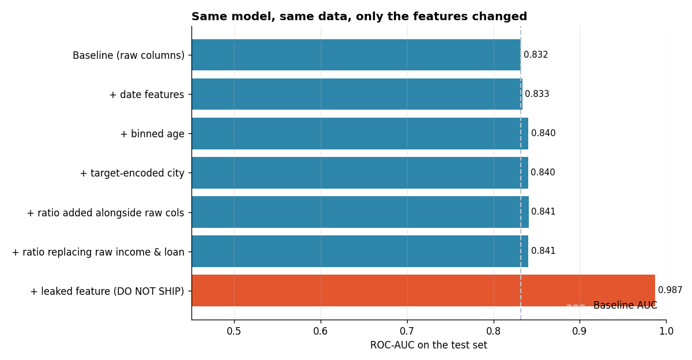

# Feature Engineering for Machine Learning

**Tools:** Python, Scikit-learn, Pandas, NumPy, Matplotlib

**File:** [`Feature Engineering for Machine Learning.py`](./Feature%20Engineering%20for%20Machine%20Learning.py)

**Chart:** [`charts/feature_engineering_impact.png`](./charts/feature_engineering_impact.png)



## What I Learned

Today asks: how much of a model's accuracy actually comes from the **features**, separately from the algorithm? **Feature engineering** means creating, transforming or combining raw columns into forms a model can use better. Analogy: raw ingredients versus a prepped mise en place. The same vegetables cook into a better dish once washed, chopped and seasoned correctly, same ingredients, better form.

The business question: predicting loan default, will this borrower miss a payment? And a second, sharper question underneath it: what is the difference between a feature that genuinely helps and one that secretly cheats?

To isolate the effect of the features themselves, **the same logistic regression model is used in every single step.** Only the columns fed into it change.

## Workflow

| Step | What happens | Why it matters |
|------|--------------|----------------|
| 0 | Build a sample loan-default dataset | A realistic business problem, not a toy |
| 1 | Baseline: raw columns only | What a rushed first pass looks like |
| 2 | Extract date features (weekday, month) | A raw date is almost useless to a model on its own |
| 3 | Bin a continuous variable (age) | Lets a linear model fit a curve it otherwise cannot |
| 4 | K-fold target encoding for a categorical | A leakage-safe alternative to one-hot encoding |
| 5 | An interaction feature (income ÷ loan amount) | Tests whether a combined signal beats two separate ones |
| 6 | A worked example of target leakage | The single most common reason models fail in production |
| 7 | Final comparison | All results on one chart, same model throughout |

## Results (simulated data, 4,000 loan applications, 25% test set)

| Step | ROC-AUC |
|------|---------|
| Baseline (raw columns) | 0.832 |
| + date features (`is_weekend`) | 0.833 |
| + binned age | 0.840 |
| + target-encoded city | 0.840 |
| + income/loan ratio, added alongside raw columns | 0.841 |
| + income/loan ratio, replacing the raw columns | 0.841 |
| + leaked feature (`collections_called`) | **0.987** |

*The data is simulated, so these numbers describe the exercise, not a real business.*

## Key Concepts and Interview Points

**Binning lets a linear model bend.** Age's real effect in this data is U-shaped: safest around the middle of the range, riskier at both extremes. A single linear coefficient on raw age cannot express a curve at all; splitting age into bands lets the model learn a separate coefficient per band, effectively fitting a step-function approximation of the curve. The grouped default rates make the U-shape visible directly: 21-30 at 13.0%, 31-40 at 20.6%, 41-50 at 22.4%, 51-65 at 15.3%.

**Target (mean) encoding must be done with K-fold discipline, or it leaks.** One-hot encoding a high-cardinality categorical (many cities, postcodes, SKUs) creates a large number of sparse columns. Target encoding instead replaces each category with its average outcome rate, one column instead of many, but naively computing that average using a row's own label lets the row effectively vote on its own answer, a quiet leak. The fix: compute each row's encoded value using only the **other** folds, never its own, the same training-only discipline used for threshold tuning in Day 13.

**A genuinely useful negative result: the interaction feature barely helped here.** The income-to-loan ratio was the actual hidden rule used to generate this data, the single biggest driver of default. Yet adding it (AUC 0.841) barely beat binning and target encoding alone (0.840), and replacing the two raw columns with the ratio made no further difference either. The reason: logistic regression's two separate coefficients on income and loan amount can locally approximate a ratio fairly well across a limited data range, so the "obviously important" engineered feature added little the model could not already infer. **An engineered feature is only as valuable as what the model could not already work out on its own**, and that depends on both the chosen model and the range of the data, not on how intuitively important the feature sounds. This is the same kind of honest, non-cherry-picked finding as Day 14's result that logistic regression beat the tree-based models on that data.

**Target leakage is the single most common reason a model looks great in testing and fails in production.** `collections_called` pushed AUC from about 0.84 to 0.987, but the field is only ever set **after** a payment has already been missed. At the moment a loan application is actually scored, that information does not exist yet. A model trained on it would be unusable in production despite its glowing test score, and it would fail silently rather than loudly, since nothing in the code would error out. Always ask of every feature: **"Would this value actually be available at the moment I need to make the prediction?"** If the answer is no, or "only sometimes," it cannot be used, however much it improves the metric.

**Leakage is not always this obvious.** A field named `collections_called` is an easy case to catch by inspection. Leakage is often subtler: a feature that is technically available at prediction time but was itself computed using future information (an average that includes rows from after the prediction date), or a feature correlated with the target only because of how the training data happened to be collected. The general test stays the same regardless of how well hidden the leak is: would this exact value exist, unchanged, at the real moment of prediction?

**Comparing results fairly means changing one thing at a time.** Every step in this script reuses the identical `LogisticRegression` pipeline; only the input columns change between rows of the results table. This is what makes the comparison a fair test of the *features*, rather than a comparison muddled by also changing the model, which is the same discipline Day 14 used to compare a tree, a forest and logistic regression on the identical dataset and split.

**Date columns hide more signal than they show.** A raw timestamp is, to most models, just a very large number with no obvious structure. The useful signal, weekday pattern, month, recency, has to be extracted explicitly, as first covered for time-indexed data in Day 9. Here it was a smaller contributor (0.832 to 0.833) than binning or encoding, a reminder that not every engineered feature carries equal weight, and that is only knowable by testing.

**Correlation can understate a genuinely important feature.** The income/loan ratio's correlation with default (-0.293) looks weaker than raw income's correlation alone (-0.324), yet the ratio was literally the variable used to generate the data. Correlation is a linear measure and can miss or understate relationships that are threshold-like or otherwise non-linear, a caution worth carrying into how correlation tables are read anywhere in this project.

## How to Run

```bash
pip install numpy pandas scikit-learn matplotlib
python "Feature Engineering for Machine Learning.py"
```

The script prints each step and saves the chart in a `charts` folder next to it. The random seed is fixed, so your results match those above.

## Next Steps

- Repeat the ratio-feature comparison with Day 14's decision tree instead of logistic regression, since a tree cannot approximate a ratio from two separate linear terms the way logistic regression can
- Add a second, more clearly non-linear interaction and see whether it survives the same "added vs replacing" test this script applies
- Build a small checklist of leakage questions to run through before any model is shipped, as a companion piece to this script
- Try scikit-learn's built-in `TargetEncoder` (model_selection-aware) and compare it with the hand-written K-fold version here
