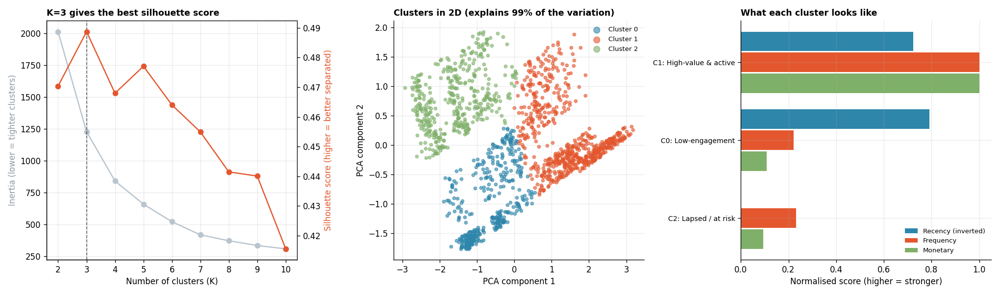

# K-Means Clustering for Customer Segmentation

**Tools:** Python, Scikit-learn, Pandas, NumPy, Matplotlib

**File:** [`K-Means Clustering for Customer Segmentation.py`](./K-Means%20Clustering%20for%20Customer%20Segmentation.py)

**Chart:** [`charts/kmeans_clusters.png`](./charts/kmeans_clusters.png)



## What I Learned

Day 10 segmented customers using **hand-written rules**: "recency score 4+ and frequency score 4+ means Champion." That works, but a human had to decide the thresholds. Today asks a different question: *if we hand the same recency, frequency and monetary data to an algorithm with no rules at all, does it find similar groups on its own?*

**K-means** groups points so that points in the same group sit close together. Analogy: drop K magnets onto a table scattered with iron filings. Each filing snaps to its nearest magnet; each magnet then moves to the centre of the filings nearest it; repeat until nothing moves. The "filings" here are customers, plotted by recency, frequency and spend.

## Workflow

| Step | What happens | Why it matters |
|------|--------------|----------------|
| 0 | Rebuild Day 10's RFM table (same seed, same customers) | Lets today's clusters be compared with that day's rule-based segments |
| 1 | Log-transform and scale the features | K-means needs every feature on the same footing |
| 2 | Elbow method and silhouette score across K = 2 to 10 | Pick the number of clusters with evidence, not a guess |
| 3 | Fit K-means, profile and name each cluster | Turn cluster numbers into a business story |
| 4 | Cross-tab clusters against Day 10's RFM segments | Check whether the algorithm "rediscovers" the human rules |
| 5 | Visualize with PCA | See clusters that live in 3+ dimensions on a flat chart |

## Results (same 1,500 simulated customers as Day 10)

**Choosing K:** the silhouette score peaked at **K = 3** (0.489), though it stayed fairly flat (0.44 to 0.49) across K = 2 to 7. This matters: the "best" K by the metric is not always the most *useful* K for the business. More on this below.

**The three clusters found, with no rules given to the algorithm:**

| Cluster | Customers | % | Avg. days since last order | Avg. orders | Avg. total spend | Label |
|---------|-----------|---|------------------------------|-------------|-------------------|-------|
| 1 | 669 | 44.6% | 75.0 | 9.5 | Rs. 19,799 | **High-value & active** |
| 0 | 420 | 28.0% | 56.4 | 2.1 | Rs. 2,159 | **Low-engagement** |
| 2 | 411 | 27.4% | 270.7 | 2.2 | Rs. 1,870 | **Lapsed / at risk** |

**Comparing with Day 10's rule-based segments** (rows = Day 10 segment, columns = today's cluster):

| RFM segment (Day 10) | Cluster 0 | Cluster 1 | Cluster 2 |
|------------------------|-----------|-----------|-----------|
| Champions | 0 | **338** | 0 |
| Loyal Customers | 99 | 170 | 0 |
| At Risk | 11 | 161 | 121 |
| Need Attention | **82** | 0 | 0 |
| New / Promising | **211** | 0 | 0 |
| Hibernating | 17 | 0 | **290** |

Every Champion from Day 10 landed in Cluster 1, and most Hibernating customers landed in Cluster 2, with no overlap. Without being told any thresholds, K-means found boundaries that line up closely with the human-written RFM rules. That is a reassuring sign that both methods are picking up a real pattern in the data, not inventing one.

**PCA:** two components captured 99% of the variation in the scaled data, so the 2D chart is a trustworthy picture of the clusters, not a distorted one.

*The data is simulated, so these numbers describe the exercise, not a real business.*

## Key Concepts and Interview Points

**Scaling is not optional for K-means.** It measures straight-line distance between points. Monetary values run into the tens of thousands while recency is in the hundreds, so without scaling, monetary would dominate every distance calculation, like comparing people using height in millimetres and weight in tonnes. This is the opposite of Day 14's trees, which needed no scaling at all, a good contrast to mention in an interview on when preprocessing matters.

**Log-transform skewed features before scaling.** Monetary and frequency are right-skewed (a few big spenders), so `log1p` pulls in the extreme values before `StandardScaler` acts on them, giving a distance measure that better reflects typical differences between customers.

**Elbow method vs silhouette score.** The elbow method looks for where adding another cluster stops meaningfully reducing inertia (how tightly points hug their centre). It always keeps falling, so the "elbow" is a judgement call, and that call can be genuinely ambiguous, as it is here. Silhouette score (-1 to 1) instead asks "is each point closer to its own cluster than to the next nearest one?" and gives one clear number to maximise. Using both together is stronger than either alone.

**The "best" K is a business decision, not just a statistic.** The silhouette score was fairly flat across K = 2 to 7, meaning several values of K are nearly equally valid by the maths. A finer K (say 5 or 6) might match marketing's needs better even if its silhouette score is a touch lower. State this trade-off explicitly rather than treating the metric as the final word; this is exactly the kind of judgement interviewers probe for.

**K-means makes an assumption: round, similar-sized clusters.** It struggles with groups that are long, thin, or very different in size or density. RFM data tends to form fairly round, separated blobs (as the PCA chart shows), which is part of why it works well here. For oddly shaped groups, DBSCAN or Gaussian Mixture Models are often better choices; know the assumption so you can recognise when it breaks.

**Run K-means several times (`n_init`).** It starts from random initial positions and can settle into a worse local solution depending on where it starts, like a hiker who stops at the first hilltop reached instead of searching for the tallest peak. Scikit-learn's `n_init=10` reruns the whole algorithm 10 times and keeps the best result automatically.

**PCA is for seeing, not for deciding.** The clustering itself was done on the original scaled features; PCA only compresses the result down to 2D so humans can look at it. Never cluster on the PCA output when the original features are this few and already meaningful, since that would throw away interpretability for no benefit.

**Unsupervised vs supervised learning.** Day 8, 13 and 14 all had a labelled answer to predict (sales, churn). K-means gets no labels at all; it only finds structure in the inputs. This is **unsupervised learning**, and it is genuinely useful when no labelled "correct answer" exists yet, such as segmenting a customer base for the very first time.

**Rules vs algorithm: use both, not one instead of the other.** Rule-based RFM segments are transparent and easy to explain to any stakeholder; clustering can reveal structure nobody thought to encode as a rule, and here it validated the rule-based segments instead of contradicting them. In practice, running both and comparing, as this script does, builds confidence in the result.

**Cluster labels are arbitrary and must be assigned after fitting.** K-means calls its groups 0, 1, 2 with no inherent meaning or order, and the numbering can change between runs. The script's `name_cluster` function labels each cluster from its own average recency, frequency and spend, rather than hard-coding "cluster 1 = Champions", which would break the moment the data or run order changes.

## How to Run

```bash
pip install numpy pandas scikit-learn matplotlib
python "K-Means Clustering for Customer Segmentation.py"
```

The script prints each step and saves the chart in a `charts` folder next to it. The random seed is fixed, so your results match those above.

## Next Steps

- Re-run with K = 5 or 6 and compare the finer segments with marketing's needs
- Try Gaussian Mixture Models and see whether soft (probabilistic) cluster membership tells a richer story
- Add product category mix as a feature and see if it changes the groups
- Track how customers move between clusters from one quarter to the next
