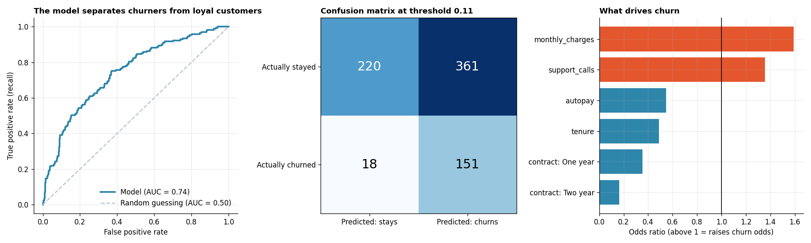

# Logistic Regression for Churn Prediction

**Tools:** Python, Scikit-learn, Pandas, NumPy, Matplotlib

**File:** [`Logistic Regression for Churn Prediction.py`](./Logistic%20Regression%20for%20Churn%20Prediction.py)

**Chart:** [`charts/churn_model_results.png`](./charts/churn_model_results.png)



## What I Learned

Day 8 predicted a **number** (sales). Today predicts a **category**: will this customer churn, yes or no? That is a **classification** problem, and it needs different tools and different ways of judging success.

**Logistic regression** is the standard first model for yes/no questions. Despite the word "regression" in its name, it outputs a **probability between 0 and 1**, and you then choose a cut-off (a **threshold**) above which you act. Analogy: a weather forecast says "70% chance of rain", and **you** decide at what percentage you carry an umbrella.

The business question: *which telecom customers are most likely to leave, so the retention team can contact them first?*

## Workflow

| Step | What happens | Why it matters |
|------|--------------|----------------|
| 1 | Build a customer dataset (about 22% churn) | Realistic imbalance: most customers stay |
| 2 | One-hot encode, scale, and stratified split inside a `Pipeline` | Same steps for train and test, no leakage |
| 3 | Baseline: "nobody churns" | Shows why accuracy alone is misleading |
| 4 | Fit logistic regression, read the confusion matrix | See exactly which mistakes the model makes |
| 5 | Precision, recall, F1, ROC-AUC | The right metrics for classification |
| 6 | Choose the threshold from business costs | Turn a model into a money-saving decision |
| 7 | Odds ratios | Explain what drives churn in plain language |
| 8 | Score a new customer | Show how the model is used day to day |

## Results (simulated data, 3,000 customers; 750 in the test set)

**The accuracy paradox:**

| Model | Accuracy | Churners caught (recall) |
|-------|----------|--------------------------|
| Baseline: nobody churns | 77.5% | **0%** |
| Logistic regression, threshold 0.50 | 78.7% | 21.9% |
| Logistic regression, threshold 0.11 | 49.5% | **89.3%** |

The useless baseline scores 77.5% accuracy because most customers stay. A model that looks "worse" on accuracy can be far more useful for the business.

**Detailed metrics:**

| Threshold | Precision | Recall | F1 | ROC-AUC |
|-----------|-----------|--------|-----|---------|
| 0.50 (default) | 0.569 | 0.219 | 0.316 | 0.743 |
| 0.11 (chosen by cost) | 0.295 | 0.893 | 0.443 | 0.743 |

**Confusion matrices:**

| | Threshold 0.50 | Threshold 0.11 |
|---|---------------|----------------|
| Correctly kept (TN) | 553 | 220 |
| Wrongly flagged (FP) | 28 | 361 |
| Missed churners (FN) | 132 | 18 |
| Caught churners (TP) | 37 | 151 |

**Business cost on the test set** (a missed churner costs Rs. 5,000, a wasted retention offer costs Rs. 500):

| Strategy | Total cost |
|----------|-----------|
| Do nothing (no model) | Rs. 845,000 |
| Model at threshold 0.50 | Rs. 674,000 |
| Model at threshold 0.11 | **Rs. 270,500** |

**Odds ratios** (per +1 standard deviation for numbers):

| Feature | Odds ratio | Reading |
|---------|-----------|---------|
| Monthly charges | 1.59 | Higher bills raise churn odds by about 59% |
| Support calls | 1.36 | More calls raise churn odds by about 36% |
| Autopay | 0.55 | Autopay roughly halves the odds |
| Tenure | 0.49 | Long-standing customers are much safer |
| Contract: One year | 0.35 | Versus month-to-month |
| Contract: Two year | 0.16 | Strongest protective factor |

**Example:** a customer with 4 months of tenure, a high bill, 4 support calls, a month-to-month contract and no autopay gets a churn probability of about **83%**, so the model flags them for the retention team.

*All data is simulated, so these numbers describe the exercise, not a real business.*

## Key Concepts and Interview Points

**The accuracy paradox.** With 78% non-churners, "predict that everyone stays" is 78% accurate and completely useless. For imbalanced problems (fraud, churn, disease), never report accuracy alone. This is one of the most common interview questions on classification.

**Read the confusion matrix first.** It has four boxes: true negatives, false positives, false negatives and true positives. Every other metric is built from these four numbers.

**Precision vs recall (in plain words).**

| Metric | Question it answers | Formula idea |
|--------|--------------------|--------------|
| Precision | Of the customers I flagged, how many really churned? | TP / (TP + FP) |
| Recall | Of all the customers who churned, how many did I catch? | TP / (TP + FN) |
| F1 | A single balance of the two | Harmonic mean |

Analogy: a fishing net. A wide net (high recall) catches most fish but also a lot of rubbish (low precision). A tight net is cleaner but misses fish.

**There is always a trade-off.** Lowering the threshold catches more churners (recall up) but flags more people who would have stayed (precision down). No threshold is "correct" by itself.

**Choose the threshold from business costs, not from 0.5.** Here, missing a churner costs 10 times more than a wasted offer, so we should flag generously. For a well-calibrated model the break-even threshold is about `cost_FP / (cost_FP + cost_FN)`, which is about 0.09 here, and the data-driven search landed at 0.11. In an interview, say: *"I would ask what each type of mistake costs before choosing the threshold."*

**Tune the threshold on training data, not the test set.** The script finds the threshold using cross-validated predictions on the training data and only then applies it to the test set. Tuning on the test set would make the final score look better than it really is, a form of data leakage.

**ROC-AUC measures ranking, not a single cut-off.** AUC is the probability that the model gives a higher score to a random churner than to a random loyal customer. 0.5 is a coin flip and 1.0 is perfect, so 0.74 is a useful but not spectacular model. Notice that AUC stays the same at every threshold, because it does not depend on one.

**Odds ratios make the model explainable.** The coefficient is a change in log-odds, and exponentiating it gives an odds ratio. Above 1 raises churn odds, below 1 lowers them. Because the numeric features were scaled, the ratios can be compared fairly. Retention teams act on explanations like "contract type and bill size matter most", not on raw maths.

**Probability vs odds.** Probability is "22 out of 100 churn". Odds are "22 churn for every 78 who stay". Logistic regression works on odds, which is why its coefficients are not simple percentage changes in probability.

**Why `stratify=y`.** When one class is rare, a random split can leave the test set with too few churners. Stratifying keeps the churn share the same in both sets.

**Pipelines prevent leakage.** Fitting the scaler on all the data before splitting lets test-set information leak into training. A `Pipeline` learns scaling only from the training data and applies it unchanged to the test data.

**Other ways to handle imbalance.** Besides moving the threshold: `class_weight="balanced"`, oversampling the minority class (SMOTE), or collecting more positive examples. Threshold tuning is the simplest and often enough.

**Assumptions to state honestly.** The cost calculation assumes every flagged churner is saved by the offer. In reality offers work only part of the time, which would push the best threshold higher.

## How to Run

```bash
pip install numpy pandas scikit-learn matplotlib
python "Logistic Regression for Churn Prediction.py"
```

The script prints each step and saves the chart in a `charts` folder next to it. The random seed is fixed, so your results match those above.

## Next Steps

- Try `class_weight="balanced"` and compare its recall and precision with the threshold approach
- Compare with a Random Forest or Gradient Boosting model on the same data
- Plot a precision-recall curve, which is more informative than ROC for very rare classes
- Add the retention offer's success rate to the cost model and see how the best threshold moves
