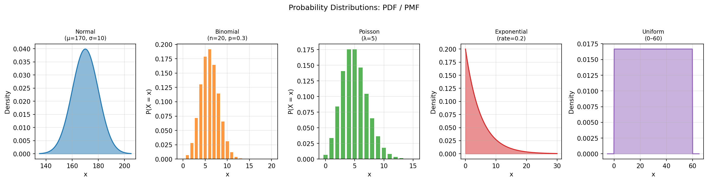
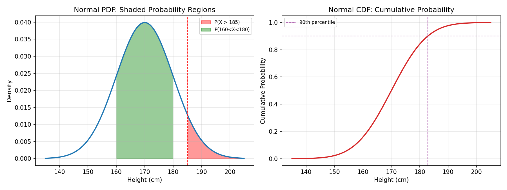
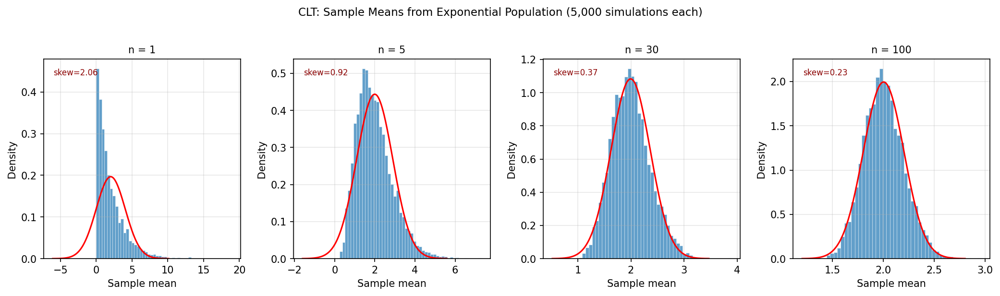
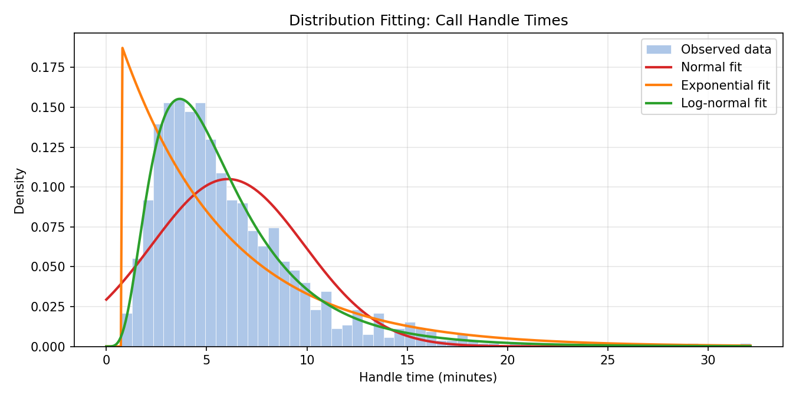

# Probability Distributions & the Central Limit Theorem

**Subject:** Statistics &nbsp;|&nbsp; **Tools:** Python, NumPy, SciPy, Pandas, Matplotlib

> **Three questions, one script:**
> 1. *What shape does my data follow?*
> 2. *What is the probability of a specific outcome?*
> 3. *Why does the normal distribution appear everywhere?*

---

## The Core Analogy

A **distribution** is a rulebook that tells you how likely each possible value is. Every dataset follows some rulebook — even if you cannot see it directly.

The **Central Limit Theorem (CLT)** says: even if the original rulebook is weird and lopsided, the rulebook for the *average of many samples* always turns into a bell curve. This is why banks, doctors, and data analysts can use the same normal-distribution tools on almost any dataset once they have enough data.

---

## How to Run

```bash
pip install numpy scipy pandas matplotlib
python probability_distributions_clt.py
```

Fixed seed (`42`) → identical output every run.

---

## The Five Distributions

| Distribution | Shape | Use it when |
|---|---|---|
| **Normal** | Symmetric bell curve | Heights, weights, measurement errors, test scores |
| **Binomial** | Discrete, bell-ish | Count of successes in N yes/no trials (defects, conversions) |
| **Poisson** | Discrete, right-skewed | Count of rare events in a fixed window (calls per hour, bugs per sprint) |
| **Exponential** | Continuous, right-skewed | *Time between* Poisson events (minutes until next call) |
| **Uniform** | Flat rectangle | Every value equally likely (random number generators, shuffles) |



> **Interview point:** Binomial and Poisson are related. When `n` is large and `p` is small in a Binomial, it approximates a Poisson with `λ = n × p`. So instead of Binomial(n=10,000, p=0.0005), you can use Poisson(λ=5) and get the same answer far faster.

---

## Three Tools Every Distribution Gives You

| Tool | What it returns | Real question it answers |
|---|---|---|
| **PDF / PMF** | Probability *at* one exact value | "How likely is exactly 5 calls?" |
| **CDF** | Probability *up to* a value | "How likely is ≤ 5 calls?" |
| **PPF** (inverse CDF) | Value at a given probability | "What is the 90th percentile?" |

> **Interview point:** CDF and PPF are inverses. `CDF(x) = p` and `PPF(p) = x` always. If you know one, you can always get the other. This is how you find cut-offs, thresholds and percentiles.



---

## Part 1 — Key Stats of Each Distribution

```
                        Mean  Std Dev  Skewness  Kurtosis
Distribution
Normal(μ=170, σ=10)    170.0   10.000     0.000     0.000
Binomial(n=20, p=0.3)    6.0    2.049     0.195    -0.062
Poisson(λ=5)             5.0    2.236     0.447     0.200
Exponential(λ=0.2)       5.0    5.000     2.000     6.000
Uniform(a=0, b=60)      30.0   17.321     0.000    -1.200
```

**Skewness:** 0 means symmetric; positive means a right tail (most values clustered on the left, occasional large values). Exponential has skewness 2 — the textbook "long right tail" distribution.

**Kurtosis:** 0 for Normal (the benchmark). Positive means heavier tails and a sharper peak. Exponential at 6 has very heavy tails — extreme values are far more common than a normal distribution would predict.

> **Interview point:** Uniform has kurtosis −1.2. Negative kurtosis means *lighter* tails than normal — the distribution is flat and bounded, so there are no extreme outliers. This is the key reason you should never model real business data as uniform unless you are absolutely sure there is a hard cap on both sides.

---

## Part 2 — Practical Probability Questions

### Normal — Employee heights (μ=170, σ=10)

```
P(height > 185 cm)     = 6.68%
P(160 < height < 180)  = 68.27%    ← the famous "68% rule" (within 1 std dev)
90th percentile height = 182.82 cm
```

> **Interview point:** The 68-95-99.7 rule. About 68% of data falls within 1 standard deviation of the mean, 95% within 2, and 99.7% within 3. Memorise this — it comes up in A/B testing, anomaly detection, and quality control constantly.

### Binomial — Quality control (n=20 units, p=5% defect rate)

```
P(0 defects)             = 35.85%
P(≤ 2 defects)           = 92.45%
P(≥ 3 defects) [reject]  =  7.55%
```

A batch of 20 passes QC with 92.45% probability. That means about 1 in 13 batches gets rejected even with a 5% defect rate and a 3-defect threshold. If that rejection rate is too high, you either tighten the process or raise the threshold — and the Binomial tells you exactly what each option costs.

### Poisson — Call centre (λ=12 calls/hour)

```
P(exactly 12 calls)       = 11.44%
P(> 15 calls) [overload]  = 15.56%
P(≤ 8 calls) [quiet hour] = 15.50%
```

> **Interview point:** For Poisson, the mean equals the variance. Always. This is a diagnostic: if someone gives you count data and says "the mean is 12 but the variance is 40", the data is **overdispersed** and Poisson is the wrong model. You would use a Negative Binomial instead.

### Exponential — Customer arrivals (rate=0.2/min, mean wait=5 min)

```
P(next customer < 3 min)  = 45.12%
P(wait > 10 min)          = 13.53%
Median wait time          = 3.47 min   ← median < mean: right-skewed
```

> **Interview point:** The exponential distribution is **memoryless**. If you have already waited 7 minutes, the probability of waiting 3 more minutes is the same as if you had just arrived. Mathematically: P(X > 10) = P(X > 7) × P(X > 3). The script verifies this in check V6. This property is what makes Markov chains and queuing models tractable.

---

## Part 3 — Central Limit Theorem Demonstration

**Population:** Exponential(rate=0.5) — heavily right-skewed, skewness = 2.02.

We draw 5,000 samples of size `n` and compute each sample mean. The table below shows what happens as `n` grows:

```
     Predicted SE  Observed SE  Skewness Shapiro-Wilk p Normal?
n
1          2.0000       2.0283    2.0574         0.0000   NO  ✗
5          0.8944       0.8993    0.9230         0.0000   NO  ✗
10         0.6325       0.6322    0.6213         0.0000   NO  ✗
30         0.3651       0.3684    0.3725         0.0098   NO  ✗
50         0.2828       0.2786    0.2885         0.0712   YES ✓
100        0.2000       0.2000    0.2311         0.0617   YES ✓
```



**Reading the table:**

- **Predicted SE vs Observed SE:** the formula `σ/√n` predicts the spread of sample means precisely — even at n=1. This part of the CLT works immediately, regardless of normality.
- **Skewness falls steadily** from 2.06 at n=1 to 0.23 at n=100. The shape is converging.
- **Shapiro-Wilk says NO at n=30** — but this is a large-sample artefact, not a contradiction. With 5,000 simulations, the test is powerful enough to detect the tiny remaining skew (0.37), which is visually invisible. The CLT is a limiting result; n=30 is close enough for most real-world work, which is why the rule of thumb stands.
- **YES starts at n=50** for this strongly skewed population. For a mildly skewed population, n=30 is usually enough.

> **Interview point:** The CLT is why you can run a z-test or t-test on almost anything as long as your sample is large enough. The individual data points do not need to be normal — only the *sample mean* needs to be approximately normal, and the CLT guarantees that once n is large enough.

> **Interview point:** The standard error formula `SE = σ/√n` has a direct implication: to halve the margin of error in an A/B test, you need **four times** as many observations, not twice. This is why large-scale experiments are expensive.

---

## Part 4 — Distribution Fitting & Goodness-of-Fit

Real data rarely announces its own distribution. You fit candidates and test.

**Data:** synthetic call-handle times (secretly log-normal), n=1,000.

```
Mean  = 6.06 min | Median = 5.09 min | Skew = 1.825 | Max = 32.11 min
```

**Kolmogorov-Smirnov test** (p > 0.05 → data is consistent with this distribution):

```
              KS Statistic  KS p-value  Good fit?
Distribution
Normal              0.1161      0.0000    NO  ✗
Exponential         0.1703      0.0000    NO  ✗
Log-normal          0.0132      0.9943    YES ✓
```



The tell was the positive skew and mean > median. A normal distribution is symmetric; both Normal and Exponential fail badly. Log-normal fits with p = 0.99 — essentially perfect.

> **Interview point:** Log-normal is extremely common in business data — salaries, revenue per customer, time-to-convert, session durations. The reason is the **multiplicative growth** effect: if something grows by random percentage increases over time (sales rep performance × territory × product × economy), the log of the result is a sum of many small random things, and the CLT says that sum approaches normal — so the original variable approaches log-normal.

> **Interview point:** The KS test measures the maximum gap between the empirical CDF and the theoretical CDF. A small KS statistic means the two CDFs are never far apart anywhere — the fitted distribution tracks the data across its entire range, not just at the mean.

---

## Verification — All 7 Checks Passed

| # | What was checked | Method |
|---|---|---|
| V1 | Normal CDF at 185 | Re-derived from the error function `erf` |
| V2 | 90th percentile is above the mean | Logical necessity for symmetric dist |
| V3 | Binomial P(0 defects) = (1−p)^n | Direct formula |
| V4 | P(≥ 3 defects) = 1 − CDF(2) | Complementary probability |
| V5 | CLT standard error within 5% of predicted | All 6 sample sizes checked |
| V6 | Exponential memoryless property | P(X>10) = P(X>7) × P(X>3) |
| V7 | Exponential CDF = 1 − e^(−rate×t) | Direct formula |

---

## Full Run Output

```
=================================================================
SECTION 1 — Distribution Key Stats
=================================================================
                        Mean  Std Dev  Skewness  Kurtosis
Distribution
Normal(μ=170, σ=10)    170.0   10.000     0.000     0.000
Binomial(n=20, p=0.3)    6.0    2.049     0.195    -0.062
Poisson(λ=5)             5.0    2.236     0.447     0.200
Exponential(λ=0.2)       5.0    5.000     2.000     6.000
Uniform(a=0, b=60)      30.0   17.321     0.000    -1.200

=================================================================
SECTION 2 — Practical Probability Questions
=================================================================
Normal(μ=170 cm, σ=10 cm) — employee heights
  P(height > 185 cm)        = 0.0668  (6.68%)
  P(160 < height < 180)     = 0.6827  (68.27%)
  90th percentile height    = 182.82 cm

Binomial(n=20, p=0.05) — defects in a batch of 20
  P(0 defects)              = 0.3585  (35.85%)
  P(≤ 2 defects)            = 0.9245  (92.45%)
  P(≥ 3 defects) [reject]   = 0.0755  (7.55%)

Poisson(λ=12) — calls per hour at a call centre
  P(exactly 12 calls)       = 0.1144  (11.44%)
  P(> 15 calls) [overload]  = 0.1556  (15.56%)
  P(≤ 8 calls) [quiet hour] = 0.1550  (15.50%)

Exponential(rate=0.2/min) — time between customer arrivals
  Mean wait time            = 5.0 min
  P(next customer < 3 min)  = 0.4512  (45.12%)
  P(wait > 10 min)          = 0.1353  (13.53%)
  Median wait time          = 3.47 min

=================================================================
SECTION 3 — Central Limit Theorem Demonstration
=================================================================
Population: Exponential(rate=0.5)  [highly right-skewed]
  True mean          = 2.0000
  True std dev       = 2.0000
  Observed mean      = 2.0070
  Observed std dev   = 2.0106
  Observed skewness  = 2.0229  (0 = perfectly symmetric)

Sample means of n draws from the skewed population (5,000 simulations each):
     Predicted SE  Observed SE  Skewness Shapiro-Wilk p Normal?
n
1          2.0000       2.0283    2.0574         0.0000   NO  ✗
5          0.8944       0.8993    0.9230         0.0000   NO  ✗
10         0.6325       0.6322    0.6213         0.0000   NO  ✗
30         0.3651       0.3684    0.3725         0.0098   NO  ✗
50         0.2828       0.2786    0.2885         0.0712   YES ✓
100        0.2000       0.2000    0.2311         0.0617   YES ✓

Rule of thumb: sample means look normal once n ≥ 30.

=================================================================
SECTION 4 — Distribution Fitting (Goodness-of-Fit)
=================================================================
Call-handle time data (synthetically log-normal, n=1,000):
  Mean  = 6.06 min | Median = 5.09 min
  Skew  = 1.825 | Max = 32.11 min

Kolmogorov-Smirnov goodness-of-fit test (p > 0.05 → good fit):
              KS Statistic KS p-value Good fit?
Distribution
Normal              0.1161     0.0000     NO  ✗
Exponential         0.1703     0.0000     NO  ✗
Log-normal          0.0132     0.9943     YES ✓

Log-normal wins. The positive skew (long tail of long calls) is the tell.

=================================================================
VERIFICATION
=================================================================
All 7 verification checks passed.

Saved 4 charts to charts/
```

---

## Interview Cheat Sheet

| Question | Answer |
|---|---|
| What is a probability distribution? | A function that maps every possible value to its probability (or density for continuous variables). |
| Difference between PDF and CDF? | PDF gives probability *at* one point; CDF gives probability *up to* a point. Integrate the PDF to get the CDF. |
| State the CLT. | As sample size n grows, the distribution of the sample mean approaches Normal(μ, σ²/n), regardless of the population's shape. |
| Why does n≥30 matter? | It is the rule-of-thumb threshold at which the CLT approximation is good enough for most practical work, though heavy-tailed populations may need more. |
| When is Poisson appropriate? | Events that are rare, independent, and happen at a constant average rate in a fixed window. |
| Normal vs log-normal? | Normal for things that can be negative; log-normal for things that are strictly positive and multiplicatively driven (revenue, durations). |
| What does the KS test measure? | The largest vertical gap between the empirical and theoretical CDF curves. |

---

## Try Next

- Fit distributions to your own dataset and test them with `scipy.stats.kstest`
- Build a QQ-plot to visualise how well a normal fit works
- Explore the **Negative Binomial** for overdispersed count data
- Connect this to A/B Testing — the CLT is the justification for using z-tests
- Try the **Bootstrap** as an alternative to the CLT for small samples
