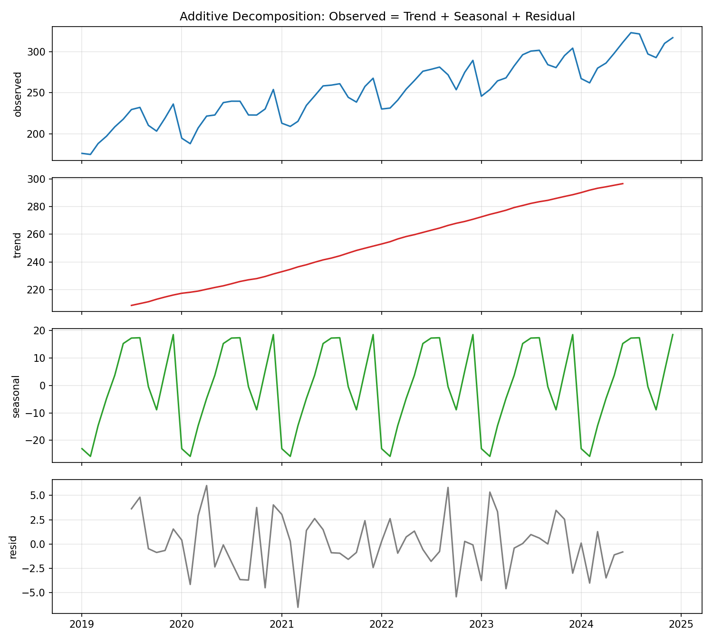

# Seasonal Decomposition and Forecast Backtesting

**Tools:** Python, Pandas, NumPy, Matplotlib (no statsmodels needed)

**File:** [`Seasonal Decomposition and Forecast Backtesting.py`](./Seasonal%20Decomposition%20and%20Forecast%20Backtesting.py)

**Chart:** [`charts/decomposition.png`](./charts/decomposition.png), [`charts/forecast_backtest.png`](./charts/forecast_backtest.png)




> **Two questions, one script:**
> 1. *What is inside my time series?* (trend + seasonality + noise)
> 2. *Which simple forecasting method is actually best?* (tested honestly on months the model never saw)

---

## The Real-World Analogy

Think of monthly ice-cream sales. Three things are mixed together:

- **Trend**: the shop is slowly growing year after year.
- **Seasonality**: summers are busy, winters are quiet, and this repeats every year.
- **Noise**: a rainy Saturday, a street festival, random luck.

**Decomposition** separates these layers like pulling apart a layer cake, so you can see each one alone. **Backtesting** then asks: "If I had used forecasting method X in the past, how wrong would I have been?" It is a driving test for forecasts: you only trust a method after it passes on roads it has not seen.

---

## Files in This Folder

| File | What it is |
|---|---|
| `seasonal_decomposition_forecasting.py` | Data generation, decomposition, 5 forecasting methods, 2 backtests, verification, charts |
| `decomposition.png` | Observed, trend, seasonal and residual panels |
| `forecast_backtest.png` | Three forecasts vs the held-out actuals |
| `README.md` | This file |

## How to Run

```bash
pip install pandas numpy matplotlib
python seasonal_decomposition_forecasting.py
```

The data uses a fixed seed (`7`), so the numbers are identical every run.

---

## Part 1: Classical Additive Decomposition

**Model:** `observed = trend + seasonal + residual`

Steps the code follows:

1. **Trend** via a **2 x 12 centred moving average**. A plain 12-month average sits *between* two months, so we average two neighbouring 12-month averages to land exactly on a month. The first 6 and last 6 months have no trend value (not enough neighbours on one side), so exactly **12** values are `NaN`.
2. **Detrend**: `observed - trend`. What is left is seasonality plus noise.
3. **Seasonal index**: average the detrended values for each calendar month (all Januaries, all Februaries ...). Averaging cancels the noise and keeps the repeating pattern.
4. **Centre the indices** so they sum to zero. Otherwise the seasonal layer would secretly carry some of the level.
5. **Residual**: whatever trend and seasonality could not explain.

> **Interview point:** *Additive vs multiplicative.* Use additive when seasonal swings stay the same size (always about +20 in July). Use multiplicative when swings grow with the level (July is always +10%). Seasonal bars that get taller as the trend rises is the warning sign for multiplicative.

> **Interview point:** The residual should look like random noise with no pattern. If you can still see waves in the residual, the decomposition missed something, such as a second seasonality or a structural break.

---

## Part 2: The Five Forecasting Methods

| Method | Idea (plain English) | Good when |
|---|---|---|
| **Naive** | Next month = last month | No trend, no seasonality |
| **Seasonal naive** | Next month = same month last year | Strong seasonality, flat level |
| **Moving average (12)** | Average of the last 12 months | Noisy but stable series |
| **Simple exp. smoothing** | Weighted average; recent months count more (`alpha = 0.3`) | Level drifts slowly, no seasonality |
| **Seasonal naive + drift** | Last year's same month, plus last year's yearly growth | Seasonality **and** a steady trend |

> **Interview point:** Naive and seasonal naive are **benchmarks**. Any fancy model (ARIMA, Prophet, LSTM) that cannot beat seasonal naive is not worth deploying. Say this in an interview and you sound like someone who has shipped forecasts.

---

## Part 3: Two Ways to Backtest

**Single hold-out:** hide the last 12 months, forecast them from earlier data only, compare. Simple, but you get one score from one slice of history.

**Rolling origin (a.k.a. time-series cross-validation):** start with 36 months of training, forecast the next 3, slide forward one month, repeat. This gives **34 test windows** instead of one, so the ranking is far more trustworthy.

> **Interview point:** Never shuffle time series data for train/test splits. Shuffling lets the model "peek" at the future. Always split by time, and train only on the past.

**Error metrics**

- **MAE**: average size of the miss, in the original units. Easy to explain.
- **RMSE**: squares errors first, so big misses hurt more.
- **MAPE**: error as a percentage of the actual value, good for comparing across series. It breaks when actual values are near zero.

---

## Real Run Output

This is the actual, unedited output from running the script:

```text
Series: 72 monthly points | 2019-01-01 to 2024-12-01 | mean 252.36 | min 175.03 | max 322.93

Estimated trend slope: 1.549 per month (true value used to build data: 1.500)
Residual std dev: 2.86 (noise std dev used to build data: 4.00)

Seasonal index per month (estimated vs true):
     estimated   true   gap
Jan     -23.06 -23.67  0.61
Feb     -25.87 -27.67  1.80
Mar     -14.67 -13.67 -1.00
Apr      -4.72  -3.67 -1.05
May       3.73   4.33 -0.60
Jun      15.31  14.33  0.98
Jul      17.32  20.33 -3.01
Aug      17.43  16.33  1.10
Sep      -0.44   0.33 -0.77
Oct      -8.86  -7.67 -1.19
Nov       5.25   2.33  2.92
Dec      18.58  18.33  0.25 

Single hold-out backtest (last 12 months):
                          MAE   RMSE  MAPE_%
method                                      
Seasonal naive + drift   3.08   4.04    1.06
Seasonal naive          15.68  16.17    5.28
Simple exp. smoothing   16.92  19.91    5.72
Naive                   17.31  20.77    6.05
Moving average (12)     21.55  25.05    7.07 

Rolling-origin backtest (3-month horizon, many origins):
                          MAE  n_origins
Seasonal naive + drift   4.99         34
Moving average (12)     16.19         34
Simple exp. smoothing   16.86         34
Naive                   18.43         34
Seasonal naive          18.47         34 

All 7 verification checks passed (max gap to true seasonality = 3.02, tolerance 5.37, correlation 0.9951).
Saved: decomposition.png, forecast_backtest.png
```

### Decomposition


### Forecast vs Actual (Backtest)


---

## How to Read the Results

**Decomposition worked.**
- The data was built with a trend of **+1.500 per month**; decomposition estimated **+1.549**.
- The seasonal pattern was recovered with a correlation of **0.9951** against the true pattern. The largest single-month gap is about **3 units** (July and November), which is normal noise, because each month's index averages only about 5 yearly values.
- The residual standard deviation (**2.86**) is *below* the true noise (**4.00**). That looks odd but is expected: the trend and seasonal estimates absorb a little of the noise, and the 12 edge months are excluded from the residual.

**Backtest story.**
- **Seasonal naive + drift wins both tests**: MAE **3.08** on the single hold-out and **4.99** in the rolling test.
- **Plain seasonal naive scores 15.68** on the single hold-out. The series grows about 18 units a year (1.5 x 12), and seasonal naive copies last year's value without adding that growth, so it is consistently about one year of growth too low.
- **The ranking changes between tests.** On the single hold-out, seasonal naive is 2nd best. In the rolling test it is 2nd *worst* (18.47). One slice of history would have given a misleading ranking. This is exactly why rolling-origin evaluation exists.
- **Moving average and exponential smoothing lag a trending series** because they forecast a flat level equal to a past average, so they are always behind a growing series.

> **Interview point:** "Which model is best?" always depends on what is *in* the series. Decompose first, then pick a method that matches the structure: seasonality needs a seasonal method, a trend needs drift or a trend term.

> **Note on the data:** The series is synthetic, so we know the true trend, seasonality and noise and can check the decomposition against them. On real data you would not have that luxury, which is why backtesting matters.

---

## How the Results Were Verified

The script ends by printing `All 7 verification checks passed`.

1. **Components add back up**: trend + seasonal + residual equals the observed series.
2. **Seasonal indices sum to zero** over one full cycle.
3. **Centred moving average recomputed by hand** at one month using the explicit 2 x 12 weights.
4. **Exactly 12 NaN trend values** (6 at each end), nothing more.
5. **Recovered seasonality matches the truth**: max gap is within 3 standard errors (tolerance 5.37) and correlation exceeds 0.99.
6. **One MAE recomputed by hand** (seasonal naive on the hold-out).
7. **Naive forecast is a flat line** at the last observed value.

While building this, the first run **failed check 5**. The July gap was 3.01 and my cutoff was an arbitrary 3.0. Rather than just loosening the number, I worked out the expected sampling error (noise sd 4 / sqrt(5) is about 1.8 per month) and replaced the cutoff with 3 standard errors plus a correlation test. A threshold should come from reasoning about the noise, not from whatever makes the test pass.

---

## Common Pitfalls

| Pitfall | Why it hurts | Fix |
|---|---|---|
| Random train/test split | Future leaks into training | Split by time only |
| Judging on one hold-out | One slice can mislead (see the rank flip above) | Use rolling-origin backtests |
| Using seasonal naive on a growing series | Always lags by one year of growth | Add drift or a trend term |
| Using MAPE with values near zero | Division blows up | Use MAE or a scaled error |
| Forgetting edge NaNs from the centred MA | Trend is undefined at both ends | Use a one-sided method for the latest months |
| Picking additive when swings grow with the level | Poor fit, patterned residual | Try multiplicative or a log transform |

---

## Interview Cheat Sheet

- **Define decomposition:** "Splitting a series into trend, seasonality and residual so each can be understood and modelled separately."
- **Why a centred moving average?** "A 12-month window has no middle month, so I average two adjacent windows to centre the trend on a real month."
- **Why benchmark with naive methods?** "They are the bar every complex model must clear."
- **Why rolling-origin?** "It gives many test windows, so the ranking of methods is stable and not an accident of one period."
- **How would you do this in practice?** Decompose to understand the data, benchmark with seasonal naive plus drift, then try ETS or ARIMA and keep them only if they beat the benchmark in a rolling backtest.
- **Limitations:** classical decomposition assumes a fixed seasonal pattern and cannot handle shifts in seasonality or multiple seasonal cycles. STL decomposition relaxes this.

---

## Try Next (Extensions)

- Switch to **multiplicative** decomposition on a series whose swings grow.
- Add **Holt-Winters** (trend + seasonal exponential smoothing) and compare it with the drift benchmark.
- Try **STL** from statsmodels on the same data.
- Add **prediction intervals** by bootstrapping the residuals.
- Backtest with a **6-month horizon** and watch how the ranking changes.
